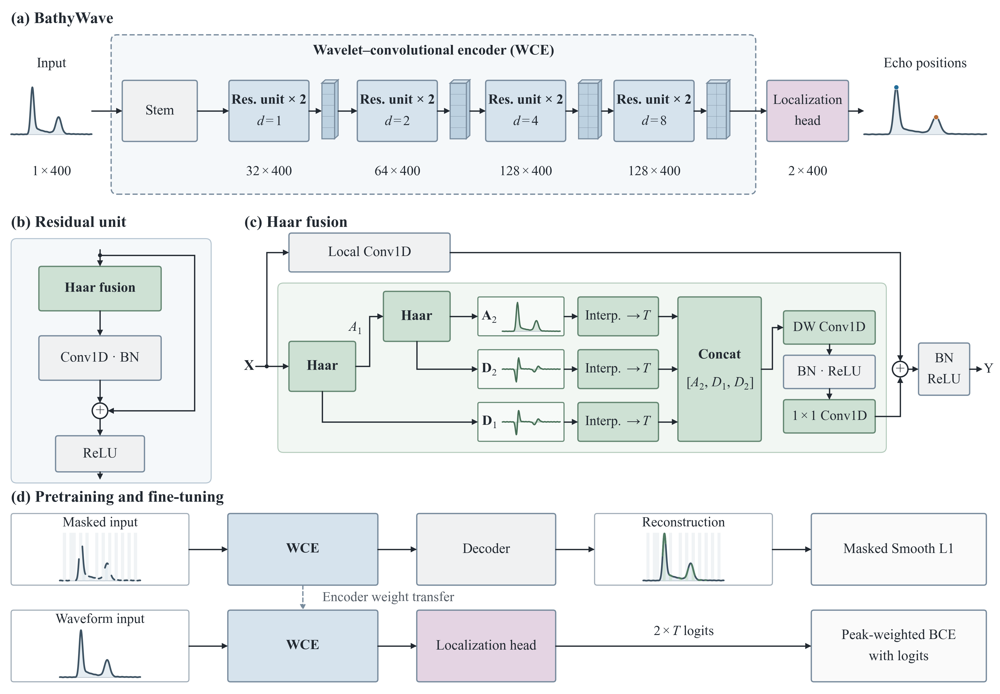

# BathyWave

[中文](README_zh.md)

BathyWave combines masked waveform pretraining with a wavelet–convolutional encoder for water-surface and water-bottom echo localization in full-waveform airborne LiDAR bathymetry.



## Installation

Python 3.10 with PyTorch 2.5.1 and NumPy 1.23.5. Install the appropriate [PyTorch CPU or CUDA build](https://pytorch.org/get-started/previous-versions/#v251) for your device, then run from the repository root:

```sh
python -m pip install -r requirements.txt
```

## Quick start

Prepare the arrays below in a local directory, then replace the example paths in the commands.

| File | Shape | Content |
|---|---|---|
| `waveforms.npy` | `(N, 400)` | Raw waveform amplitudes |
| `surface.npy` | `(N,)` | Surface sample positions; required for fine-tuning |
| `bottom.npy` | `(N,)` | Bottom sample positions; required for fine-tuning |

Positions are zero-based: `0 <= surface < bottom < 400`. Waveforms are normalized internally by subtracting the fifth percentile, clipping negative values, and scaling to [0, 1].

```sh
# 1. Pretrain the encoder
python -m bathywave pretrain --config configs/pretrain.json --data path/to/unlabeled_inputs --output runs/pretrain --device cuda

# 2. Fine-tune for echo localization
python -m bathywave finetune --config configs/finetune.json --data path/to/labeled_inputs --encoder runs/pretrain/encoder.pt --output runs/finetune --device cuda

# 3. Predict echo positions
python -m bathywave infer --data path/to/inputs --checkpoint runs/finetune/final_model.pt --output runs/predictions --device cuda
```

Fine-tuning transfers only encoder weights and trains the encoder and a randomly initialized localization head together. Pretraining uses masked Smooth L1; localization uses Gaussian targets and peak-weighted BCE with logits.

Use `--device cpu` for CPU execution, `--resume` to continue training, and `--help` for command options. A separate `--validation` directory requires unique, non-overlapping `sample_ids.npy` strings in both training and validation directories.

Inference saves `surface.npy` and `bottom.npy` in input row order using channel-wise argmax. Optional `--incidence-angle-deg` enables depth conversion with a constant beam angle from vertical and a 1 ns sampling interval. Other intervals or per-waveform angles can be supplied through `bathywave.utils.echo_positions_to_depth`.

## License

[MIT](LICENSE).
