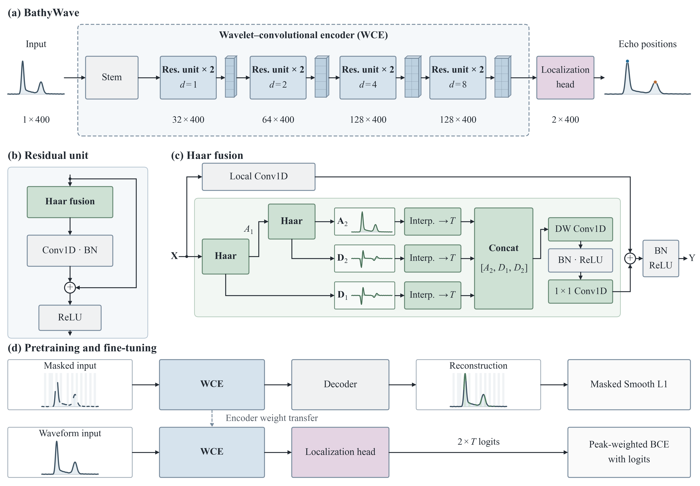

# BathyWave

[English](README.md)

BathyWave 结合掩码波形预训练与小波卷积编码器，实现全波形机载激光测深中的水面和水底回波定位。



## 安装

使用 Python 3.10，运行依赖为 PyTorch 2.5.1 和 NumPy 1.23.5。先按设备安装 [PyTorch 的 CPU 或 CUDA 版本](https://pytorch.org/get-started/previous-versions/#v251)，所有命令均在仓库根目录执行：

```sh
python -m pip install -r requirements.txt
```

## 快速开始

在本地目录中准备以下数组，再替换命令中的示例路径。

| 文件 | 形状 | 内容 |
|---|---|---|
| `waveforms.npy` | `(N, 400)` | 原始波形幅值 |
| `surface.npy` | `(N,)` | 水面采样点位置，微调时必需 |
| `bottom.npy` | `(N,)` | 水底采样点位置，微调时必需 |

位置索引从 0 开始，满足 `0 <= surface < bottom < 400`。代码内部减去波形幅值的第 5 百分位数、截断负值，再归一化到 [0, 1]。

```sh
# 1. 编码器预训练
python -m bathywave pretrain --config configs/pretrain.json --data path/to/unlabeled_inputs --output runs/pretrain --device cuda

# 2. 回波定位微调
python -m bathywave finetune --config configs/finetune.json --data path/to/labeled_inputs --encoder runs/pretrain/encoder.pt --output runs/finetune --device cuda

# 3. 回波位置预测
python -m bathywave infer --data path/to/inputs --checkpoint runs/finetune/final_model.pt --output runs/predictions --device cuda
```

微调只迁移编码器权重，并将编码器与随机初始化的定位头共同训练。预训练使用掩码位置上的 Smooth L1；定位采用高斯软标签和峰值加权 BCE with logits。

使用 `--device cpu` 切换到 CPU，`--resume` 断点续训，`--help` 查看命令选项。使用独立的 `--validation` 目录时，训练集和验证集均需提供 `sample_ids.npy`，其中的字符串标识应唯一且互不重叠。

推理通过逐通道 argmax 解码，按输入顺序输出 `surface.npy` 和 `bottom.npy`。可选参数 `--incidence-angle-deg` 使用相对于竖直方向的固定光束角度和 1 ns 采样间隔进行水深转换。其他采样间隔或逐波形角度可通过 `bathywave.utils.echo_positions_to_depth` 传入。

## 许可证

[MIT](LICENSE)。
